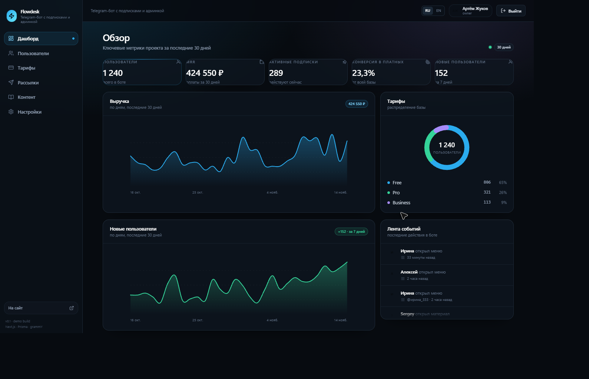

# Flowdesk

**Telegram-бот с подписками, оплатой и двуязычной админ-панелью.**
Демо-кейс для портфолио: от `/start` в боте до метрик, рассылок и управления контентом в панели.

[](https://github.com/bakkka/flowdesk/actions/workflows/ci.yml)



## Что внутри

**Бот (grammY)**

- онбординг с выбором языка RU/EN, язык запоминается в профиле;
- тарифы Free / Pro / Business, оплата картой (мок) и Telegram Stars;
- выдача материалов по уровню подписки, апселл на заблокированных;
- профиль: тариф, срок действия, количество платежей;
- уведомление администратору о новом платеже.

**Админка (Next.js 15 + Server Actions)**

- дашборд: пользователи, MRR, активные подписки, конверсия, выручка и рост по дням, распределение по тарифам, лента событий;
- пользователи: поиск, фильтры, пагинация, карточка с платежами и событиями, смена тарифа, блокировка;
- тарифы: CRUD, цены в рублях и Stars, состав, порядок, видимость;
- рассылки: сегменты (все / без подписки / Pro / Business / неактивные), двуязычный текст, черновик или отправка, статистика доставки;
- контент: материалы с доступом по тарифу, публикация/скрытие;
- настройки: статус бота, chat id администратора, URL приложения, пересборка демо-данных;
- вход по email/паролю, scrypt-хеши, HMAC-подписанные сессии, защита всех разделов.

**Двуязычность** — RU/EN переключается на сайте и в админке, выбор хранится в cookie.

## Стек

| Слой | Технологии |
| --- | --- |
| Frontend | Next.js 15 (App Router), React 19, TypeScript, Tailwind CSS |
| Backend | Server Actions, Prisma ORM, SQLite (локально) → Postgres (прод) |
| Bot | grammY, Telegram Bot API, Telegram Stars |
| Безопасность | scrypt, HMAC-сессии, httpOnly cookies |
| Инфраструктура | Vercel (план), seed-данные, детерминированный демо-набор |

## Быстрый старт

```bash
npm install
npm run setup     # prisma db push + seed (1 240 пользователей, 856 платежей, 4 200 событий)
npm run dev       # http://localhost:3000
```

Демо-доступ в админку: **admin@flowdesk.app / flowdesk**

### Бот

Бот — отдельный долгоживущий процесс (polling). Сайт и админка работают без него,
но без запущенного бота команды Telegram не обрабатываются. Без токена бот не падает,
а печатает инструкцию и выходит с кодом `0`.

1. Создайте бота у [@BotFather](https://t.me/BotFather) (`/newbot`) и скопируйте токен.
2. Укажите токен и публичную ссылку в `.env`:

```env
TELEGRAM_BOT_TOKEN="123456:ABC..."
TELEGRAM_ADMIN_CHAT_ID="123456789"          # необязательно, fallback
NEXT_PUBLIC_TELEGRAM_BOT_URL="https://t.me/your_bot"
```

3. **Chat ID администратора** удобнее задать в админке: `/admin/settings` → «Chat ID администратора».
   Значение хранится в БД (`Setting.admin_chat_id`), приоритетнее `TELEGRAM_ADMIN_CHAT_ID`
   и перечитывается ботом при каждой отправке — перезапуск не нужен.
   Свой id можно узнать у [@userinfobot](https://t.me/userinfobot) или из `getUpdates`.
4. Запустите бота и держите процесс запущенным:

```bash
npm run bot
```

5. Проверка без polling: `npm run bot:once` делает `getMe`, печатает `@username`
   и выходит. Неверный токен даёт понятную ошибку Telegram.

`NEXT_PUBLIC_TELEGRAM_BOT_URL` — необязательная ссылка на бота: она появляется на лендинге
(hero, финальный CTA, футер) и в настройках админки. `NEXT_PUBLIC_*` подставляется на этапе
сборки, поэтому после изменения нужен перезапуск `npm run dev` или redeploy. Пустое значение
скрывает ссылку.

> В production polling-процесс должен жить постоянно (Railway/Fly/VPS) либо используйте
> webhook. Vercel не держит долгоживущие процессы, поэтому бот туда не деплоится.

## Скрипты

| Команда | Что делает |
| --- | --- |
| `npm run dev` | dev-сервер |
| `npm run build` | production-сборка |
| `npm run start` | production-сервер |
| `npm run setup` | схема БД + демо-данные |
| `npm run db:seed` | пересоздать демо-данные |
| `npm run db:reset` | сбросить схему и засеять заново |
| `npm run bot` | запустить Telegram-бота (polling) |
| `npm run bot:once` | проверить токен через `getMe` и выйти |

## Структура

```
src/
  app/
    page.tsx                  публичный лендинг-кейс
    login/                    вход в админку
    admin/                    дашборд, пользователи, тарифы, рассылки, контент, настройки
    actions.ts                server actions (все мутации)
    api/locale/route.ts       переключение языка через cookie
  components/                 UI-кит, графики, навигация, макет телефона
  lib/                        Prisma, сессии, аналитика, i18n, форматирование
bot/
  index.ts                    сценарии бота
  i18n.ts                     тексты RU/EN
prisma/
  schema.prisma               модель данных
  demo-data.ts                детерминированный генератор демо-данных
docs/
  case-study.md               описание кейса и решений
  portfolio-package.md        тексты для портфолио и Upwork
```

## Решения, которые стоит подсветить на защите

- **Server Actions вместо REST** — меньше кода, меньше рассинхрона, типы общие.
- **Детерминированный seed** — демо всегда выглядит одинаково, скриншоты воспроизводимы.
- **Мок-оплата за интерфейсом провайдера** — можно заменить на реальный эквайринг, не трогая бота.
- **SQLite → Postgres** — смена одной строки в `schema.prisma`, Prisma абстрагирует остальное.
- **Графики на чистом SVG** — ноль зависимостей, полный контроль над стилем и весом.
- **Cookie-locale через route handler** — работает без JS и без лишней RSC-ревалидации.

## Деплой (когда будете готовы)

1. Postgres (Neon/Supabase) → поменять `provider` на `postgresql` и `DATABASE_URL`.
2. Vercel: `DATABASE_URL`, `SESSION_SECRET`, `NEXT_PUBLIC_APP_URL`, `NEXT_PUBLIC_TELEGRAM_BOT_URL`.
3. Бот — отдельный постоянно запущенный процесс (Railway/Fly/VPS), тот же `DATABASE_URL`,
   `TELEGRAM_BOT_TOKEN`; chat id задаётся в админке или через `TELEGRAM_ADMIN_CHAT_ID`.
4. `prisma migrate deploy` + seed для демо-стенда.

> Данные в демо синтетические, оплата имитируется. Это портфолио-кейс, а не продакшн-сервис.
